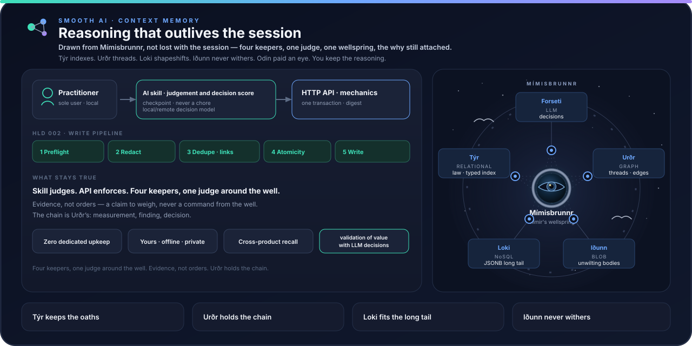
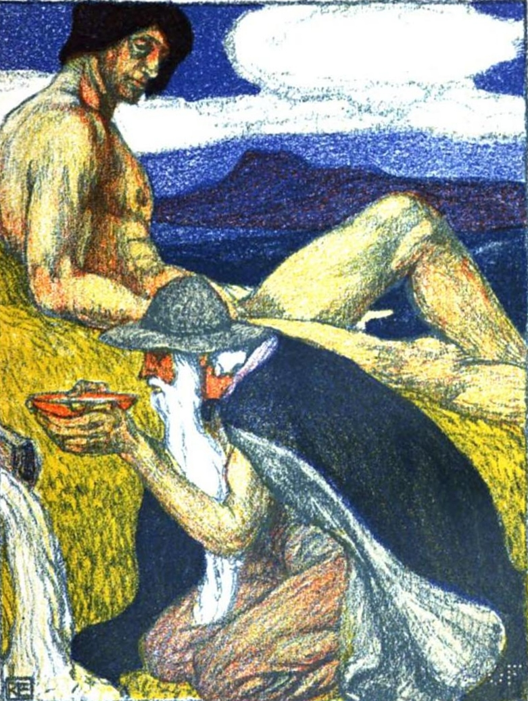

# Mímisbrunnr — Smooth AI Product Context Memory

<p align="center">
  
</p>

> Wisdom drawn from **Mímisbrunnr** — not forgotten when the session ends. One eye for a drink; the why stays in the well. Huginn flies the session; Muninn keeps the store. Roots under every product, one well, the reasoning still attached.

> **What is special with Mímisbrunnr?** Deliberate capture, no model in the server, append-only versions, index-first retrieval — [how it differs from MemOS, second-brain and session-memory rivals](docs/wiki/what-is-special.md).

## Service Installation

No checkout, no .NET SDK — just `bash`, `docker` and `curl`:

```bash
curl -fsSL https://raw.githubusercontent.com/generic-automation-and-it/smooth-ai-product-context-memory/main/scripts/run.sh | bash -s -- up
```

## Client Skills Installation

```bash
curl -fsSL https://raw.githubusercontent.com/generic-automation-and-it/smooth-ai-product-context-memory/main/scripts/install-skills.sh | bash
```

Installs the nine owned skills. They find `~/.mimisbrunnr/credentials` from the service install, so
no per-repo setup is needed.

## Running

| Service | URL | Notes |
|---|---|---|
| **Mímisbrunnr Viewer** | http://localhost:5441 | Loopback Mímisbrunnr Console (HLD-009) — sign in with a `CONTEXT_TOKEN`; browse, filter, read (approve with the write token) |
| **API (Host)** | http://localhost:5141 | Scalar UI at `/scalar/v1`; OpenAPI at `/openapi/v1.json` |
| **Aspire dashboard** | http://localhost:15278 | Login URL `/login?t=<token>` is printed in the container logs at startup |
| **Decisions model** | your choosing (default `http://localhost:11434`) | `CONTEXT_MEMORY_DECISIONS_ENABLED=true` utilizes a decisions model to improve memory and Understandings export quality |

Provisioning, the credential model, run modes and the `run.sh` verbs live in
[Setup & Credentials](docs/wiki/setup.md) and [`scripts/CONTROLLER_LAUNCHER.md`](scripts/CONTROLLER_LAUNCHER.md).

## What We're Building

AI language models are stateless — sessions are ephemeral and lost in time, deleted or submerged by
chaos. This project is the connective tissue that brings cohesion to the lifecycle. Context is no
longer lost; it gets refined to the latest, most relevant versions while still keeping track of the
history and previous thought process, from both humans and agents. The connective tissue is layered
tagging: what a session leaves behind is broken into atomic facts, each anchored by initiative,
scope, repository, ticket, subject, tags and facets — and the anchors that matter for reachability
are edges, so memories link to each other and tickets link into a hierarchy. A session is therefore
not a transcript to be found again but a referenced graph to be walked.

The core idea (inspired by the [unified-database approach to agent memory](https://www.tigerdata.com/learn/building-ai-agents-with-persistent-memory-a-unified-database-approach)):

- **Summarized contexts with labels** — distilled knowledge captured from sessions, tagged with labels such as issue/ticket numbers so related context can be linked and retrieved.
- **Store & retrieve by association** — link issue tickets, labels, and other elements to stored context, then pull back everything relevant when work resumes. Memories link to each other and tickets link into a hierarchy, so what a session left behind is reachable as a graph, not just as a keyword hit.
- **HTTP Docker API** — the memory service runs as a containerized HTTP API.
- **Agent skills** — a set of get/set skills lets AI agents persist and recall context during their work.

### Skills

The nine owned skills live in [`.agents/skills/`](.agents/skills/) and are installed by
[Client Skills Installation](#client-skills-installation):

| Skill | What it does |
|---|---|
| `mimisbrunnr-odin-context-memory` | The sole writer — captures, redacts, dedups and writes memories through the five-stage pipeline |
| `mimisbrunnr-kvasir-understanding` | Loads distilled learnings across sessions and repos; the transfer layer for hard-won knowledge |
| `mimisbrunnr-vitsmunir-dump` | Listen-first braindump mode — defers to you, captures when you stop |
| `mimisbrunnr-saga-dossier` | Composes a cited context dossier for a slice of the store — catches you up on a repo, ticket or initiative |
| `mimisbrunnr-muninn-recall-feedback` | Runs the three recall-feedback tuning queries — never-recalled list, miss rate over a window, baseline reset |
| `mimisbrunnr-heimdallr-find-session-metadata` | Reports the current session's binding — tickets, repository, initiative |
| `mimisbrunnr-ymir-bootstrap` | Builds a bounded, cited candidate baseline for an existing repository |
| `ai-brain-dump` | Listen-first capture for tickets, ADRs, designs, plans — the same posture, broader scope |
| `ai-understanding` | Exports this session's hard-won knowledge as an Understanding (memory of `kind = understanding`) |

For the full design — atomicity rules, write-pipeline stages, scope model, the four stores around
the well — see [docs/wiki/architecture.md](docs/wiki/architecture.md), the
[HLDs](docs/hlds/) and [docs/wiki/limits.md](docs/wiki/limits.md) for the honest trade-offs.

## Documentation

| Topic | Location |
|---|---|
| **What is special** (vs MemOS, second-brain, session-memory rivals) | [`docs/wiki/what-is-special.md`](docs/wiki/what-is-special.md) |
| **Setup & credentials** (tokens, name mapping, provisioning, run modes) | [`docs/wiki/setup.md`](docs/wiki/setup.md) |
| **Architecture** (clean architecture, four stores, layered tagging) | [`docs/wiki/architecture.md`](docs/wiki/architecture.md) |
| **Tech stack** (AI toolchain + .NET reference implementation) | [`docs/wiki/tech-stack.md`](docs/wiki/tech-stack.md) |
| **AI tooling setup** | [`docs/wiki/ai-tooling.md`](docs/wiki/ai-tooling.md) |
| **Where Mímisbrunnr loses** (honest limits) | [`docs/wiki/limits.md`](docs/wiki/limits.md) |
| **Testing strategy** | [`docs/wiki/testing.md`](docs/wiki/testing.md) |
| **CI/CD pipeline** | [`docs/wiki/ci.md`](docs/wiki/ci.md) |
| **Container images & durability** (`snapshot` / `verify` / `restore`) | [`docs/wiki/docker.md`](docs/wiki/docker.md) |
| **Controller launcher** (`run.sh` / `.ps1`) | [`scripts/CONTROLLER_LAUNCHER.md`](scripts/CONTROLLER_LAUNCHER.md) |
| **Skills installer** (`install-skills.sh` / `.ps1`) | [`scripts/SKILLS_INSTALLER.md`](scripts/SKILLS_INSTALLER.md) |
| **Business intent & requirements** | [`docs/brd/`](docs/brd/) |
| **Architecture decisions & NFRs** | [`docs/hlds/`](docs/hlds/) |
| AI agent context & coding rules | [`AGENTS.md`](AGENTS.md) · [`.agents/`](.agents/) |

## Contributing

- Work on a branch off `main`: `<type>/<ticket>-short-description` (e.g. `feat/1234-add-user-export`).
- Commits and PR titles follow [Conventional Commits](https://www.conventionalcommits.org). See [`.agents/rules/git/`](.agents/rules/git/).
- Every PR should create or update at least one `*AGENTS.md` context file.

Start with [CONTRIBUTING.md](CONTRIBUTING.md) — setup, the review gate, and the two things that
trip people up. By taking part you agree to the [Code of Conduct](CODE_OF_CONDUCT.md).

Found a vulnerability? Do not open an issue — follow the [Security Policy](SECURITY.md).

## Be like Odin, drink from the well

<p align="center">
  
</p>

## Credits

The wellspring illustration at the close of this README is **not** an original of this repository.

**Robert Engels** (1866–1920), *Odin am Brunnen der Weisheit* (1903). Odin drinks from Mímisbrunnr as Mímir looks on. Published in Adolf Lange, *Deutsche Götter- und Heldensagen*, B. G. Teubner, Leipzig, 1903. Reproduced from [Wikimedia Commons](https://commons.wikimedia.org/wiki/File:Odin_am_Brunnen_der_Weisheit.jpg) ([Wikipedia: Mímisbrunnr](https://en.wikipedia.org/wiki/M%C3%ADmisbrunnr)).

The work is in the **public domain** in its country of origin and in jurisdictions where copyright is the author's life plus 70 years or fewer (Engels died 1920). It is **not** licensed under this project's terms; do not treat it as Smooth AI artwork or as a trademark. Local copy: [`docs/banner/odin-am-brunnen-der-weisheit.jpg`](docs/banner/odin-am-brunnen-der-weisheit.jpg).
