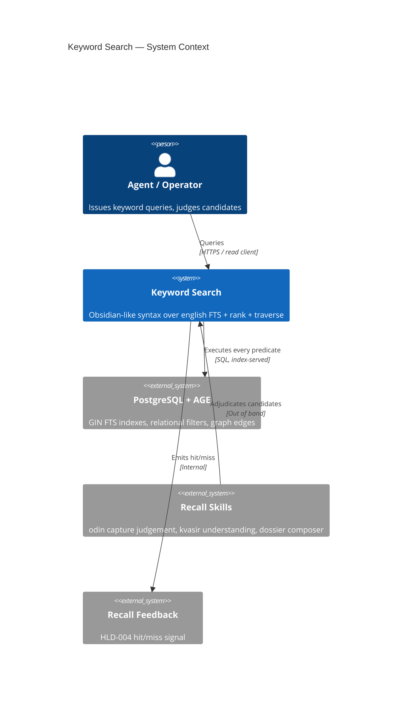
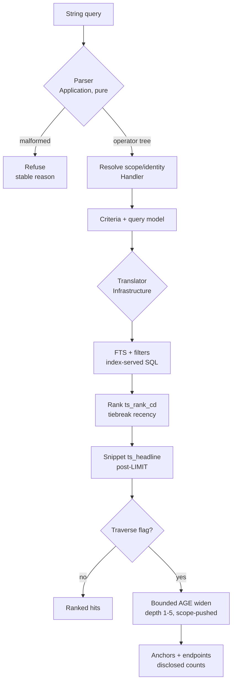
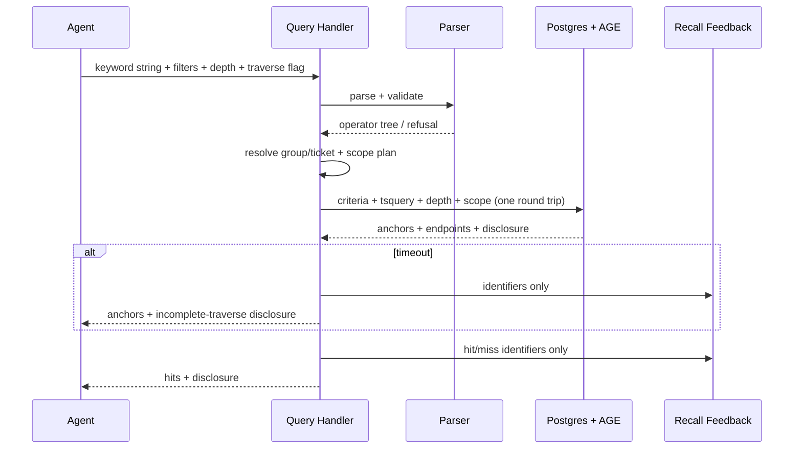

# Diagrams — Keyword Search

## System Context (C1)

Keyword search is the recall front door of the well: one query string in, ranked
evidence out. It sits between agents/operators and the PostgreSQL index it never
bypasses; judgement stays outside (capture/recall skills), bodies stay in object storage.

## Query Flow

Rationale: the parse→resolve→translate→rank→widen path is the design's load-bearing
seam (LADR-01); C1 cannot show it.

## Recall Sequence

Rationale: one composed round trip replacing ten client calls (LADR-05) needs its
participant contract explicit — especially scope enforcement on the widen leg.

