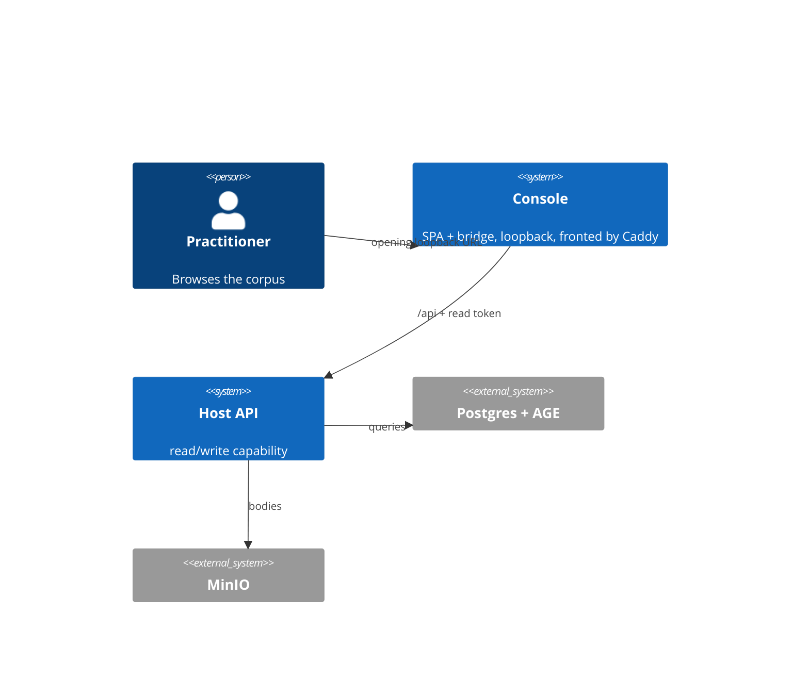

# AGENTS.md — Viewer Console (HLD)

AI Context: HLD for the viewer/management UI. Updated: 2026-10-13

## TL;DR

A loopback human-facing Console over the store API. Separate viewer pod fronted by Caddy; the bridge
drives the capture pipeline rather than reimplementing it; the browser holds no write token;
[README.md](./README.md) is the design, with LADRs under [`./ladrs/`](./ladrs/) and NFRs under
[`./nfrs/`](./nfrs/). Business authority: BRD-004 (`BR-46` … `BR-53`).

## Non-Negotiables

- **The bridge calls the capture scripts; it is never a writer and never a judge.** The "sole writer"
  invariant (HLD-002) and the no-model rule (HLD-005 §2.6) hold (LADR-03).
- **Read is ambient, write is never ambient.** Caddy injects the read token into the `/api` proxy; the
  write token is server-side and used only on an explicit approve (LADR-02, NFR-02).
- **Loopback only** (NFR-01). No network-accessible bind.
- **Browse filters map 1:1 onto the query API** — no client-side re-filtering after materialisation
  (LADR-06). Filtering in the browser would defeat the server indexes.
- **The graph is bounded** — depth ≤ the store's declared max, with an edge cap (LADR-05, NFR-05). It is
  not a graph database; it must not over-promise a rich network.
- **No-build SPA** (LADR-04). Vendored libs, no Node toolchain, served by Caddy.

## System Context

## Architecture Decisions

The high-impact ones — see [`./ladrs/`](./ladrs/) for detail:

- **LADR-01** — separate pod fronted by Caddy (Host image stays pure).
- **LADR-02** — Caddy injects read token; write token server-side only.
- **LADR-03** — the bridge drives the capture pipeline; never reimplements the gates.
- **LADR-06** — browse filters map 1:1 onto the query fields.
- **LADR-08** — read-first phasing.
- **LADR-09** — the bridge is a Python service that imports the capture client and reuses its gates.
- **LADR-10** — the review queue is derived from the store (proposed status); conflict choices and the
  dry-run digest are reproduced by re-running dedup.

## Key Behaviors

- **Approving re-runs the gates** (NFR-03): an approve is equivalent to the capture path's approve — same
  gates, same order, same veto. No write reaches the store the capture path would have refused.
- **The cheap list never carries the body.** Blobs fetch on demand when an element or version is selected
  (NFR-05).
- **Empty, unreachable and timed-out are distinct states.** The read path never collapses them; the UI
  must not either.
- **Recall feedback is not duplicated** by Console reads (NFR-06).
- **Facet any/all is an explicit control** matching the API's `FacetMatchMode` (LADR-06), and ticket
  provider/key are paired, matching the query validator.

## Migration Plans

- **No store migration.** The Console is additive.
- **The Host image stays pure.** The viewer pod carries the SPA and bridge; no UI in the API container.
- **No `Memory` → `Console` rename.** Memory is the correct name; the Console is a surface over it.

## Changelog

| Date | Change | Ref |
|:-----|:-------|:----|
| 2026-10-13 | Gap/bug/architecture loop: corrected the browse limit to query defaults (50 / max 200); rewrote the graph view to the real `/paths` path-chain contract (each `PathResult` = hops ending at a `CheapMemory` endpoint; intermediate hops are uuid refs) and to `/tickets/paths`' `Disclosure` + limit flags; made the review queue an explicit store-derived query (`Status = proposed`) with conflict choices reproduced by re-running dedup; added LADR-09 (Python bridge) and LADR-10 (queue derived / conflicts reproduced); added a Known-gaps section (G1 proposal persistence, G2 approve transition, G3 node labelling, G4 initiative/label endpoints, G5 recall-feedback limits); added same-origin/no-CORS, as-of-UTC and loopback correctness notes. | HLD-009 |
| 2026-10-13 | Created — HLD-009 Viewer Console. Renumbered from an initial 008 to avoid colliding with the existing `008-keyword-search` (In Discovery). Draft; LADRs/NFRs all Draft. Business authority BRD-004. | HLD-009 |
