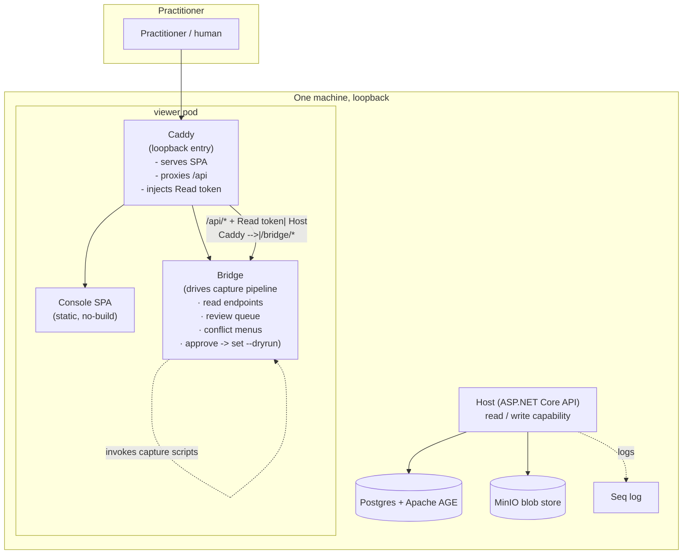

# System Context (C1)

The human opens a single loopback URL (Caddy). Caddy serves the SPA, reverse-proxies `/api` to the Host
with the read token injected, and routes `/bridge/*` to the bridge. The bridge drives the capture
pipeline; the write token is held server-side, never in the browser.

The Host is unchanged: it still owns the API, the capability split, Postgres/AGE, MinIO and Seq. The
viewer pod is additive.

## Boundaries

- **Loopback only.** Caddy and the bridge bind localhost.
- **Capability split.** Read ambient (Caddy injects read token); write never ambient (bridge holds the
  write token, used only on approve).
- **No model.** Neither the SPA nor the bridge makes a judgement the capture skill does not already make.
