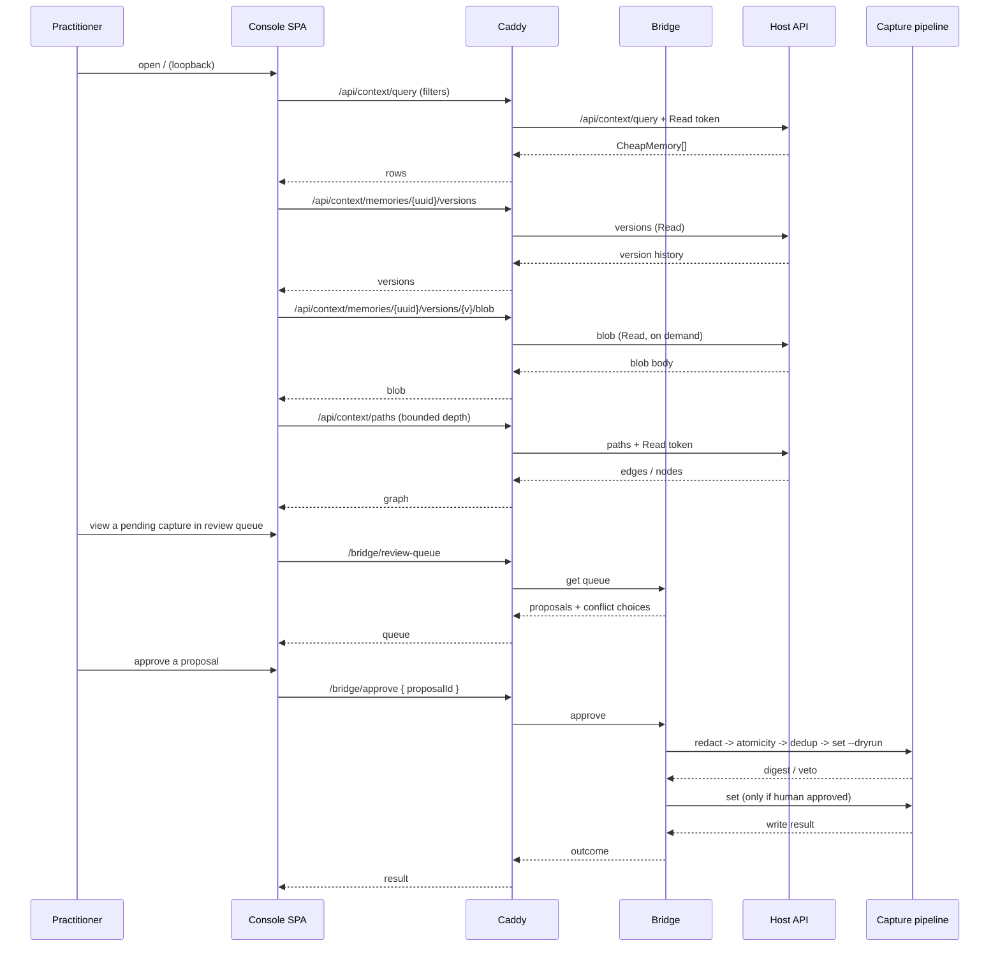

# Flow — View vs Approve

The **view** path is read-only and goes through Caddy with the injected read token. The **graph** path is
the same — bounded traversal. The **approve** path is the only write path; it re-runs the capture
pipeline's gate sequence (redaction → atomicity → dedup → `set --dryrun`) via the bridge, never a direct
write. The write token is used only inside the bridge during an approve.
