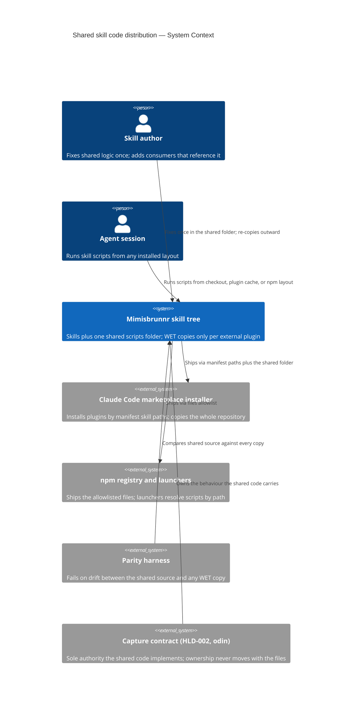

# Diagrams — Shared Skill Code Distribution

## System Context (C1)

One skill tree serves several consumers: the skills reference shared code, three
distribution routes ship it, a parity harness watches the copies, and the capture
contract owns the behaviour regardless of where the files live.

The tree is the only thing that moves; the contract, the consumers, and the routes stay
where they are.
